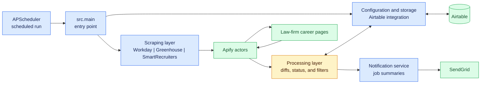

# Law Firm Job Scraper

A Python automation tool that scrapes job listings from law-firm career pages,
tracks changes in Airtable, and sends email notifications for new and closed
positions.

## Features

- Scrapes Workday, Greenhouse, and SmartRecruiters career pages through Apify
  actors.
- Stores law firms, role keywords, and job listings in Airtable.
- Detects `NEW`, `OLD`, and `CLOSED` job listings.
- Filters notifications by status, role keywords, and country.
- Sends summaries through SendGrid.
- Runs once on demand or continuously on an APScheduler schedule.

## Architecture



### Data flow

1. `src.main` loads active law firms and role keywords from Airtable.
2. `src.factories` selects the registered scraper for each ATS type.
3. The ATS adapter runs its Apify actor and validates returned data with
   Pydantic schemas.
4. The scraper compares results with previous listings and assigns `NEW`,
   `OLD`, or `CLOSED` status.
5. Every listing is upserted to Airtable. Notifications then keep only
   `NEW`/`CLOSED` listings matching the configured keywords and target country.
6. If relevant listings exist, SendGrid sends an HTML summary. Otherwise, no
   email is sent for that ATS run.

One-shot runs execute all configured ATS types concurrently. Scheduler runs
stagger ATS jobs by ten-minute increments starting at 12:00 in the configured
timezone; this schedule is defined in `src/main.py`.

## Supported ATS platforms

| Platform | Status | Implementation |
| --- | --- | --- |
| Workday | Supported | `src/services/scrapers/ats/workday.py` |
| Greenhouse | Supported | `src/services/scrapers/ats/greenhouse.py` |
| SmartRecruiters | Supported | `src/services/scrapers/ats/smartrecruiters.py` |

Actor IDs and scraper inputs are defined in the corresponding implementation
and schema modules.

## Requirements

- Python `>=3.13`
- [uv](https://github.com/astral-sh/uv)
- Airtable account and configured tables
- Apify account and API key
- SendGrid account and API key
- Docker, if running the container

## Installation

```bash
git clone https://github.com/achrafbou1/law-firm-job-tracker.git
cd law-firm-job-scraper
uv sync
```

Create a `.env` file in the project root:

```env
AIRTABLE_TOKEN=your_airtable_api_token
APIFY_API_KEY=your_apify_api_key
SENDGRID_API_KEY=your_sendgrid_api_key
SENDER_EMAIL=sender@example.com
RECEIVER_EMAIL=receiver@example.com
```

## Configuration

| Variable | Required | Description |
| --- | --- | --- |
| `AIRTABLE_TOKEN` | Yes | Airtable personal access token |
| `APIFY_API_KEY` | Yes | Apify API key |
| `SENDGRID_API_KEY` | Yes | SendGrid API key |
| `SENDER_EMAIL` | Yes | Sender address used by SendGrid |
| `RECEIVER_EMAIL` | Yes | Notification recipient |
| `DEBUG_EMAIL` | No | Optional debug recipient used by email configuration |
| `LAW_FIRM_DB_ID` | No | Airtable base ID; the application has a default |
| `RUN_ONCE` | No | Set to `1` to run once and exit |
| `ENV` | No | Set to `test` to load `.env.test` |

Settings are loaded by `src/settings.py`. The test suite automatically selects
`.env.test` when running under pytest.

## Airtable setup

The application expects these tables and field names:

### Law Firms

| Field | Type | Purpose |
| --- | --- | --- |
| `Law Firm Name` | Single line text | Firm name |
| `Active` | Checkbox | Whether to scrape the firm |
| `Careers URL` | URL | Career page URL |
| `ATS Type` | Single select | `Workday`, `Greenhouse`, or `SmartRecruiters` |
| `Schedule` | Single line text | Stored schedule metadata |
| `Last Checked` | Date | Last scrape timestamp |

### Job Listings

| Field | Type | Purpose |
| --- | --- | --- |
| `Job ID` | Single line text | Unique job identifier |
| `Job Title` | Single line text | Position title |
| `Firm` | Single line text | Law firm name |
| `Location` | Single line text | Job location |
| `Country` | Single line text | Job country |
| `Job URL` | URL | Job posting URL |
| `Status` | Single select | `NEW`, `OLD`, or `CLOSED` |
| `Role Category` | Multiple select | Matching role categories |
| `First Seen` | Date | First detection date |
| `Last Seen` | Date | Most recent detection date |
| `Actioned` | Checkbox | Whether the job was reviewed |

### Role Categories

| Field | Type | Purpose |
| --- | --- | --- |
| `ATS Search Keywords` | Long text | Comma-separated matching keywords |

These field mappings are implemented with `pyairtable` ORM models under
`src/services/airtable/models/`.

## Usage

### Run once

```bash
make dev
# or
uv run python -m src.main --once
```

### Run the scheduler

```bash
make run
# or, without Docker
uv run python -m src.main
```

### Docker

```bash
make build
docker run --name scraper-image scraper-image
```

The Docker image installs production dependencies and starts
`uv run python -m src.main`. Pass the required environment variables with
Docker's `-e` options or your deployment platform's secret configuration.

## Operations and deployment

The GitHub Actions workflow in `.github/workflows/main.yml` runs the test suite
for pushes and pull requests targeting `master`. A successful push to `master`
then builds the Docker image and deploys it to DigitalOcean over SSH. Production
credentials are supplied through GitHub environment secrets; do not commit
them to `.env`, source code, or the README.

Useful local commands:

```bash
make test
make lint
```

`make lint` runs Black and Ruff with automatic fixes.

## Testing

Tests are organized into legacy coverage, unit tests, integration tests, and
CSV fixtures:

```text
tests/
├── conftest.py
├── test_diff_check.py
├── unit/
├── integration/
└── data/
```

Run the full suite, or target a category:

```bash
uv run pytest tests/ -v
uv run pytest tests/unit/ -v
uv run pytest tests/integration/ -v
uv run pytest tests/ --cov=src --cov-report=html
```

Integration tests mock external Apify and Airtable interactions; they do not
require production credentials.

## Project layout

```text
src/
├── main.py
├── settings.py
├── constants.py
├── exceptions.py
├── factories.py
└── services/
    ├── airtable/
    │   ├── client.py
    │   └── models/
    ├── email/
    │   ├── provider.py
    │   ├── service.py
    │   └── templates/
    └── scrapers/
        ├── base.py
        ├── filters.py
        ├── ats/
        │   ├── base.py
        │   ├── apify_provider.py
        │   ├── workday.py
        │   ├── greenhouse.py
        │   └── smartrecruiters.py
        └── schemas/
            ├── workday.py
            ├── greenhouse.py
            └── smartrecruiters.py
```

## Adding a new ATS scraper

1. Add an implementation under `src/services/scrapers/ats/`.
2. Add a Pydantic schema under `src/services/scrapers/schemas/` when needed.
3. Extend `ApifyScraper` or `BaseScraper`.
4. Add the ATS value to `AtsType` in
   `src/services/airtable/models/law_firm.py`.
5. Register the scraper in `SCRAPER_REGISTRY` in `src/factories.py`.
6. Add unit and integration coverage using mocked provider responses.

Example registration:

```python
SCRAPER_REGISTRY: dict[AtsType, type[BaseScraper]] = {
    AtsType.WORKDAY: WorkdayScraper,
    AtsType.GREENHOUSE: GreenhouseScraper,
    AtsType.SMARTRECRUITERS: SmartRecruitersScraper,
    AtsType.NEW_ATS: NewATSScraper,
}
```

## Troubleshooting

### The application fails during startup

Check that all required environment variables are present and that the
credentials are valid. `pydantic-settings` rejects missing or unexpected
settings before the application starts.

### A firm is skipped

Confirm that the Airtable `ATS Type` exactly matches one of the values in
`AtsType`. Unsupported values are logged and skipped by the factory.

### No email is sent

This is expected when the run produces no `NEW` or `CLOSED` jobs matching the
configured keywords and target country. Check Airtable statuses and the
`Role Categories` keywords before investigating SendGrid.

### Tests use the wrong environment

Set `ENV=test` explicitly, or run pytest normally; the settings module detects
pytest and selects `.env.test`.

### Docker does not start

Build with `make build`, verify the required environment variables are passed to
the container, and inspect logs with `docker logs scraper-image`.

## Contributing

1. Fork the repository.
2. Create a feature branch:
   `git checkout -b feature/new-ats-support`
3. Run `make test` and `make lint`.
4. Commit your changes and push the branch.
5. Open a pull request.

## License

MIT License
